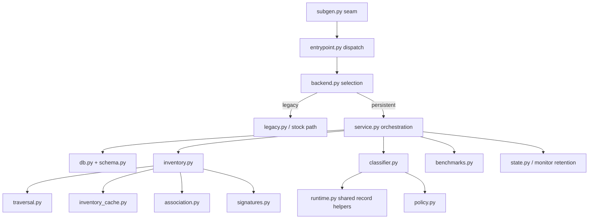
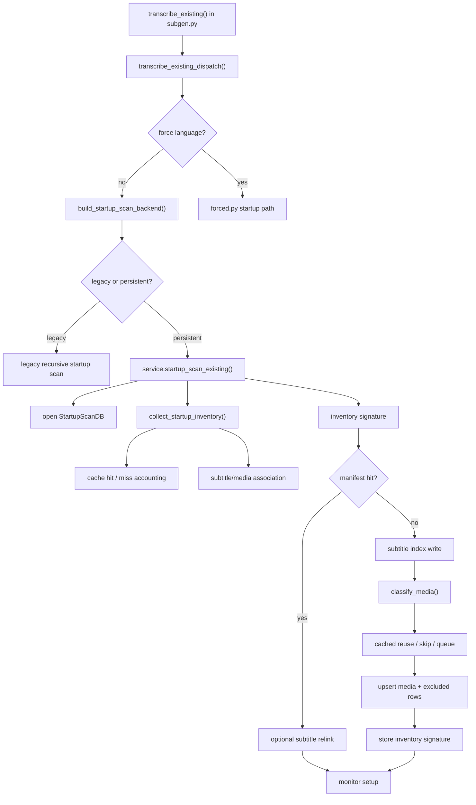
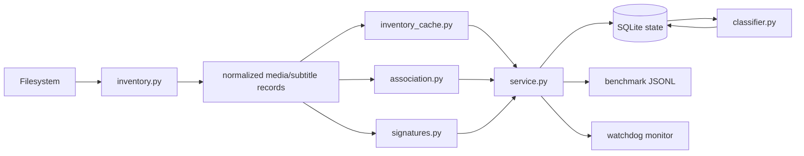
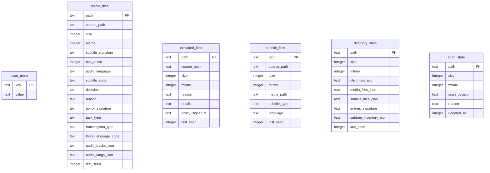
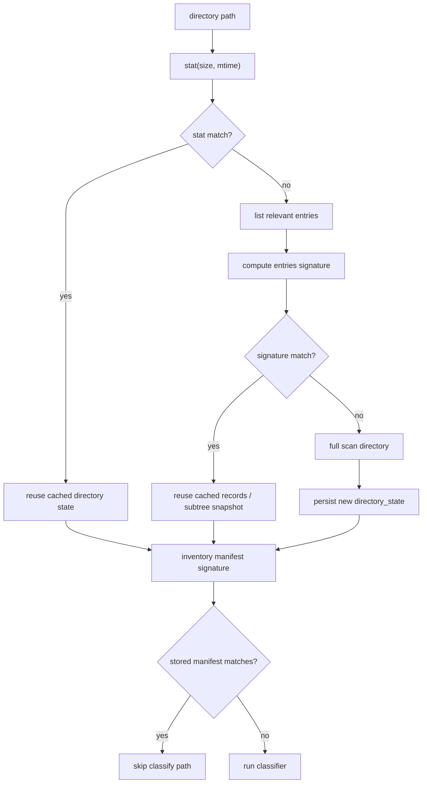

# Startup Scan Backend

This document covers the persistent startup-scan backend that was added alongside stock Subgen's legacy recursive startup scan.

It is intentionally separate from the main project README because this backend adds:

- a persistent SQLite-backed inventory
- directory and inventory fingerprinting
- cache-aware queue planning
- optional benchmark and planner-trace instrumentation
- a package boundary that makes future replay into `subgen-stock` mostly additive instead of a giant `subgen.py` fork

## Purpose

The legacy startup scan in stock Subgen walks every configured file on every start and decides skip/queue work inline.

That is simple, but it has three problems on large libraries:

1. startup cost scales with the full library every time
2. startup state is mostly transient, so warm restarts do not get much cheaper
3. performance work tends to accumulate directly inside `subgen.py`

The persistent backend exists to change that:

1. persist startup inventory and decisions across restarts
2. validate only media and subtitle changes that matter
3. separate startup-scan code into a package with clearer module boundaries
4. make startup work measurable with opt-in benchmarks

## Logging

`LOG_LEVEL` controls application output (`DEBUG`, `INFO`, `WARNING`, or `ERROR`) and takes precedence over the legacy `DEBUG` boolean. Startup scan start and completion summaries are INFO, filesystem inspection problems are WARNING, and individual cache-miss queue decisions are DEBUG. This keeps normal logs concise while allowing file-level troubleshooting when requested.

## Scope

The startup scan still begins from `TRANSCRIBE_FOLDERS` and still respects the same higher-level skip logic and queueing semantics as the stock path.

What changes is how startup work is implemented:

- `legacy` backend:
  - stock recursive scan path
  - no persistent startup inventory
  - little or no warm-start benefit
- `persistent` backend:
  - SQLite-backed startup state
  - directory cache reuse
  - manifest-hit short-circuiting
  - cache-aware planner path
  - optional benchmark output

Current runtime selection from `subgen.py`:

- default seam behavior remains `STARTUP_SCAN_BACKEND=legacy`
- opt in to the new backend with `STARTUP_SCAN_BACKEND=persistent`

## Design Goals

The backend was designed around a few explicit constraints:

1. preserve stock behavior unless the persistent backend is selected
2. treat only media files and subtitle files as startup invalidation inputs
3. keep noisy diagnostics off by default
4. make warm starts materially faster than cold starts
5. keep the future `subgen-stock` replay surface small and explicit

## High-Level Architecture



## Runtime Flow



## Data Flow



## Module Map

This package is intentionally split by responsibility so future porting back into `subgen-stock` can stay additive.

### Boundary and Dispatch

- `backend.py`
  - backend object selection
  - isolates `legacy` vs `persistent`
  - why: keep backend selection out of the main startup logic
- `entrypoint.py`
  - dispatch from the `subgen.py` seam
  - why: central place for startup routing decisions
- `legacy.py`
  - wrapper for legacy startup behavior
  - why: preserve stock behavior as an explicit backend choice

### Orchestration

- `service.py`
  - top-level persistent startup orchestration
  - opens DB, collects inventory, decides manifest hit vs full classify, writes benchmark rows, starts monitor
  - why: one place to understand end-to-end startup behavior

### Inventory and Fingerprinting

- `inventory.py`
  - startup inventory orchestration
  - coordinates recursive vs non-recursive scanning
  - coordinates cache hit, signature hit, and full-scan paths
  - why: isolate startup inventory behavior from queue planning
- `traversal.py`
  - directory walking
  - directory listing
  - record construction
  - why: keep raw filesystem traversal small and reusable
- `inventory_cache.py`
  - directory entry signatures
  - root subtree snapshots
  - cached directory-state serialization and reuse helpers
  - why: isolate cache/fingerprint logic from traversal logic
- `association.py`
  - subtitle type detection
  - subtitle language extraction from filenames
  - subtitle-to-media linking
  - sidecar-state helpers
  - why: make subtitle/media association testable and reusable
- `signatures.py`
  - inventory manifest signatures
  - subtitle signature generation and persistence helpers
  - why: keep fingerprint math and policy-sensitive hashing together

### Classification and Runtime State

- `classifier.py`
  - planner path for media records
  - cached reuse / skip / queue decisions
  - planner breakdown and trace instrumentation
  - why: this is the dominant cold-start cost center and needs isolated measurement
- `runtime.py`
  - shared DB record upsert helpers
  - processed-file refresh path
  - audio-track serialization helpers
  - why: extract durable runtime helpers from `subgen.py`
- `policy.py`
  - startup-scan policy signature
  - why: invalidate cached rows when skip/naming policy changes

### Persistence and Diagnostics

- `db.py`
  - SQLite access layer
  - row upserts and reads
  - why: isolate storage details and schema-aware access
- `schema.py`
  - schema versioning and migrations
  - why: keep migrations out of orchestration code
- `benchmarks.py`
  - opt-in JSONL benchmark writing
  - planner-detail summary helpers
  - why: keep instrumentation additive and quiet by default
- `config.py`
  - startup-scan env parsing
  - why: one place for startup-scan flag defaults and normalization
- `state.py`
  - observer retention and startup lock helpers
  - why: keep monitor lifecycle and global state out of orchestration flow
- `wiring.py`
  - small package glue helpers
  - why: minimize direct coupling from `subgen.py`

### Remaining Special Path

- `forced.py`
  - forced-language startup path
  - why: forced startup behavior is not identical to the regular persistent classify path and still benefits from isolated extraction

## Why Each Changed Part Exists

### 1. Persistent SQLite state

New parts:

- `db.py`
- `schema.py`
- `STARTUP_SCAN_DB_PATH`

Why:

- warm startup needs durable state outside container process lifetime
- subtitle inventory and exclusion decisions should survive restart
- cache validation should use persisted directory state and prior media rows

### 2. Directory-state cache

New parts:

- `directory_state` table
- `inventory_cache.py`
- root subtree snapshots

Why:

- avoid rescanning unchanged directory trees
- turn warm inventory validation into a small number of state checks
- support both stat-match and entries-signature-match reuse

### 3. Inventory manifest hit

Changed behavior:

- persistent backend computes an inventory signature for startup media/subtitle records
- if it matches the stored signature, classify work can be skipped entirely

Why:

- startup should not reclassify every cached media row when nothing relevant changed
- this is the main warm-start short-circuit

### 4. Separate planner/classifier path

New parts:

- `classifier.py`
- planner-detail instrumentation
- parallel worker count knob

Why:

- cold-start bottlenecks were dominated by media planning, not basic traversal
- planner timing needed to be measurable separately from inventory timing
- queue/skip/detect decisions became easier to optimize without rewriting traversal code

### 5. Async monitor start

Changed behavior:

- monitor startup can begin asynchronously with `STARTUP_SCAN_MONITOR_ASYNC_START=True`

Why:

- watcher initialization should not dominate warm startup wall-clock
- users care about startup completion sooner than watcher recursion cost

### 6. Opt-in benchmarking and planner traces

New parts:

- `STARTUP_SCAN_BENCHMARK_LOGGING`
- `STARTUP_SCAN_BENCHMARK` (off by default; enables benchmark collection)
- `STARTUP_SCAN_BENCHMARK_LOG_PATH`
- `STARTUP_SCAN_PLANNER_TRACE_LOGGING`
- `benchmarks.py`

Why:

- optimization work needs hard numbers
- production logs should stay quiet by default
- trace rows should be additive and safe to disable completely

### 7. Explicit backend seam

Changed structure:

- startup backend selection is isolated behind `backend.py` and the `subgen.py` seam

Why:

- future replay into `subgen-stock` should not require transplanting a whole custom `subgen.py`
- the legacy path must remain selectable

## Schema and ERD

Schema version:

- `3`

Tables used by the persistent backend:

- `scan_meta`
- `media_files`
- `excluded_files`
- `subtitle_files`
- `directory_state`
- `scan_state`



## Persistent Data Model Notes

### `media_files`

What it stores:

- the normalized startup record for a media file
- current subtitle state
- queue/exclude decision metadata
- policy-sensitive fields needed for reuse
- persisted audio-track and audio-language summaries

Why it exists:

- avoid re-probing unchanged media on every startup
- support fast queue reuse and skip reuse
- support relinking subtitles back to media

### `excluded_files`

What it stores:

- files ruled out during startup classification
- exclusion reason and details

Why it exists:

- repeated startup runs should not rediscover the same exclusion from scratch

### `subtitle_files`

What it stores:

- subtitle inventory
- linked media path when known
- subtitle type and inferred language

Why it exists:

- manifest hits still need subtitle relink repair when media links are missing
- planner skip decisions need a consistent subtitle inventory

### `directory_state`

What it stores:

- per-directory stat metadata
- serialized media/subtitle records
- entries signature
- optional root subtree snapshot

Why it exists:

- this is the warm inventory accelerator

### `scan_meta`

What it stores:

- global metadata such as the stored inventory signature

Why it exists:

- used for the manifest-hit short-circuit

## Fingerprinting and Cache Strategy

This backend intentionally invalidates only on media/subtitle-relevant changes.

Primary fingerprints:

1. directory stat match
   - compare cached `size` and `mtime` for a directory
   - cheapest cache acceptance path
2. directory entries signature
   - built from relevant child directories and relevant file names
   - ignores unrelated files such as notes or logs
3. root subtree snapshot
   - serialized subtree inventory reused when the root cache entry matches
4. inventory manifest signature
   - startup-wide fingerprint stored in `scan_meta`
   - enables manifest-hit classify short-circuit
5. subtitle signature
   - per-media fingerprint over associated subtitles
   - used for cached reuse vs requeue decisions



## Public and Internal Startup-Scan Flags

### Public / documented flags

These are surfaced in the main README and XML config.

| Variable | Default | Purpose | Why it exists |
| --- | --- | --- | --- |
| `STARTUP_SCAN_BACKEND` | `legacy` from the `subgen.py` seam | Select `legacy` or `persistent` startup behavior | Preserve stock default while allowing opt-in backend switching |
| `STARTUP_SCAN_DB_PATH` | `/subgen/state/subgen_scan.db` | SQLite path for persistent startup state | State must outlive the container process |
| `STARTUP_SCAN_BENCHMARK_LOGGING` | `False` | Enable structured JSONL benchmark rows | Performance work needs measurements, but logs should stay quiet by default |
| `STARTUP_SCAN_BENCHMARK` | `False` | Enable startup scan timing collection and JSONL output | Collect timing data only when explicitly requested |
| `STARTUP_SCAN_BENCHMARK_LOG_PATH` | `/subgen/state/startup_scan_benchmarks.jsonl` | Output path for benchmark JSONL | Keeps timing output durable and host-mounted |
| `STARTUP_SCAN_PLANNER_TRACE_LOGGING` | `False` | Emit planner sub-step timing rows | Needed to find cold planner bottlenecks |
| `STARTUP_SCAN_MONITOR_ASYNC_START` | `True` | Start monitor observer asynchronously | Prevent watcher startup from inflating warm startup wall-clock |

### Internal or advanced knobs

These are currently read by the code but are not yet surfaced in the main public README/XML tables.

| Variable | Default | Purpose | Why it exists |
| --- | --- | --- | --- |
| `STARTUP_SCAN_FORCE_REWALK` | `False` | Ignore cache reuse and force a fresh classify/inventory pass | Useful for validating cache correctness and debugging invalidation |
| `STARTUP_SCAN_IGNORE_CACHE` | alias of `STARTUP_SCAN_FORCE_REWALK` | Backward-compatible alternate name | Preserve compatibility with earlier experiments |
| `STARTUP_SCAN_CLASSIFY_WORKERS` | `min(4, cpu_count)` | Planner executor parallelism | Lets cold classify scale on larger startup batches |
| `SUBGEN_SCAN_DB_PATH` | alias of `STARTUP_SCAN_DB_PATH` | Backward-compatible DB path name | Preserve older local experiments and compose setups |

### Behavior notes

1. The package-level `backend.py` helper defaults to `persistent` if called directly.
2. The actual production seam in `subgen.py` explicitly passes `default="legacy"`.
3. That means the effective runtime default today is still `legacy`, which is the intended stock-safe behavior.

## Operational Use

### Enable the persistent backend

```env
STARTUP_SCAN_BACKEND=persistent
STARTUP_SCAN_DB_PATH=/subgen/state/subgen_scan.db
```

### Enable benchmark logging

```env
STARTUP_SCAN_BENCHMARK=true
STARTUP_SCAN_BENCHMARK_LOG_PATH=/subgen/state/startup_scan_benchmarks.jsonl
```

### Enable planner trace logging

```env
STARTUP_SCAN_PLANNER_TRACE_LOGGING=true
```

### Force a full cache bypass

```env
STARTUP_SCAN_FORCE_REWALK=true
```

### Tune planner concurrency

```env
STARTUP_SCAN_CLASSIFY_WORKERS=4
```

## Benchmarking Strategy

The startup-scan performance work uses two different benchmark styles:

1. internal JSONL timing
   - emitted only when benchmark logging is enabled
   - best for persistent backend stage-by-stage analysis
2. external wall-clock to startup completion log line
   - used for stock-vs-current apples-to-apples comparison
   - necessary because stock `subgen-stock` does not expose the internal JSONL timing path

The documented benchmark sets in this repo currently include:

1. a sanitized representative subset (`Subset A`)
   - `33` media files
   - `34` subtitle files
2. the live `/movies/downloads/nzb` comparison set used for stock-vs-current wall-clock timing
3. a full-library warm reference used as a regression guardrail

## Verified Benchmarks

These numbers summarize the current documented state from the benchmark note in the repo.

### Persistent backend, subset cold progression

| Scenario | `startup_scan.total` |
| --- | ---: |
| `bench-nzb-v3-cold.jsonl` | 135734.736 ms |
| `bench-nzb-v4-cold.jsonl` | 140393.497 ms |
| `bench-nzb-v5-cold.jsonl` | 17924.375 ms |

Meaning:

- the later planner work collapsed the cold path dramatically
- the biggest measured gain came from eliminating unnecessary planner audio-probe work on skip-heavy startup

### Persistent backend, subset warm

| Scenario | `startup_scan.total` |
| --- | ---: |
| prior warm reference | 1670.380 ms |
| fresh warm rerun | 646.011 ms |

Meaning:

- the persistent path has a real warm-start advantage

### Full-library warm reference

| Scenario | `startup_scan.total` |
| --- | ---: |
| full-library warm reference | 6826.118 ms |

### Stock vs current wall-clock

| Repo | Phase | Wall-clock |
| --- | --- | ---: |
| `subgen-stock` | cold | 166000 ms |
| `subgen-stock` | warm | 170000 ms |
| current persistent backend | cold | 26000 ms |
| current persistent backend | warm | 18000 ms |

Meaning:

- current persistent cold is about `6.4x` faster than stock cold on the same live subset
- current persistent warm is about `9.4x` faster than stock warm on the same live subset
- stock showed effectively no warm-start improvement on that path

## Why the Current Backend Is Faster

The measured gains came from several layers working together:

1. directory-state reuse
   - avoids rescanning unchanged directories
2. root subtree snapshot reuse
   - avoids recursively rebuilding records for unchanged roots
3. manifest-hit short-circuit
   - skips classify work entirely when the library inventory still matches
4. cache-aware classify path
   - reuses persisted media rows and excluded decisions
5. planner optimizations
   - defer work until it is actually needed
   - avoid duplicate audio probing
   - skip before audio probing when known subtitle rows already prove the output exists

## Known Boundaries and Current Limitations

1. Forced-language startup still has its own extracted path in `forced.py`.
   - it is separated from the main persistent startup orchestration
   - this is intentional but still a port-prep seam to keep improving
2. The benchmark and planner-trace systems are intentionally additive only.
   - new detail rows should not break older benchmark consumers
3. The public docs currently expose only the safer startup-scan flags.
   - internal tuning/debug flags exist and are documented here for completeness
4. This backend optimizes startup scanning, not transcription runtime itself.

## Stock-Port Intent

The package structure was chosen so future replay into `subgen-stock` can look like:

1. copy the additive `subgen_startup_scan/` package
2. patch a small `subgen.py` seam
3. keep `legacy` as the default
4. keep benchmark output opt-in

That is why this backend favors:

- additive modules over giant rewrites
- narrow seam helpers
- explicit backend selection
- isolated storage and benchmarking code

## Practical Reading Order

If you need to understand or debug this system quickly, read in this order:

1. `service.py`
2. `backend.py`
3. `inventory.py`
4. `inventory_cache.py`
5. `classifier.py`
6. `db.py`
7. `schema.py`

## Related Files

- [README.md](/C:/Users/Nathan/source/subgen/README.md)
- [startup_scan_pr_benchmarks.md](/C:/Users/Nathan/source/subgen/startup_scan_pr_benchmarks.md)
- [startup_scan_stock_port_prep_plan.md](/C:/Users/Nathan/source/subgen/startup_scan_stock_port_prep_plan.md)
- [startup_scan_next_improvements_plan.md](/C:/Users/Nathan/source/subgen/startup_scan_next_improvements_plan.md)
## Worker-free startup comparison

The harness runs four cases on the same dataset in separate Python processes: default cold and warm use the legacy backend; smart cold and warm use the persistent backend. The smart cold run seeds the inventory database copied into the warm run; the job journal is kept empty so warm evaluation does not short-circuit as already active. Transcription workers are intercepted, and the harness fails if generation starts.

The report contains aggregate timings, directory and file counts, per-file decision medians and p95s, and categorized skip-reason counts. It verifies directory counts and eligibility decisions across cases. A changed dataset, scan error, duplicate decision, or unresolved probe leaves relative timings unset. Per-file identifiers, paths, logs, and database state are discarded after parity checks; the saved report contains aggregate timings and counts only.

`filesystem_elapsed_ms` measures directory-entry enumeration time (`os.scandir`) and is separate from `inventory_elapsed_ms`, which includes the persistent backend's complete inventory work such as file stats and record construction. `iterator_traversal_ms` measures time spent advancing the legacy `os.walk` iterator; it overlaps directory enumeration and should not be added to it. Per-file decision timings exclude transcription and translation.

Mount or protect the media dataset read-only, put the output directory outside it, and run the command in an environment with the Subgen dependencies installed:

```powershell
rtk python tools/startup_scan_benchmark.py `
  --root "/homevideo/movies" `
  --output-dir "C:\benchmarks\subgen-startup" `
  --repetitions 1 `
  --dataset-read-only
```

`STARTUP_SCAN_BENCHMARK` remains off by default. The harness turns it on only for measured cases; its warm seed uses worker isolation with timing output disabled. The script requires an explicit read-only assertion because it cannot make a host or network mount read-only itself.
